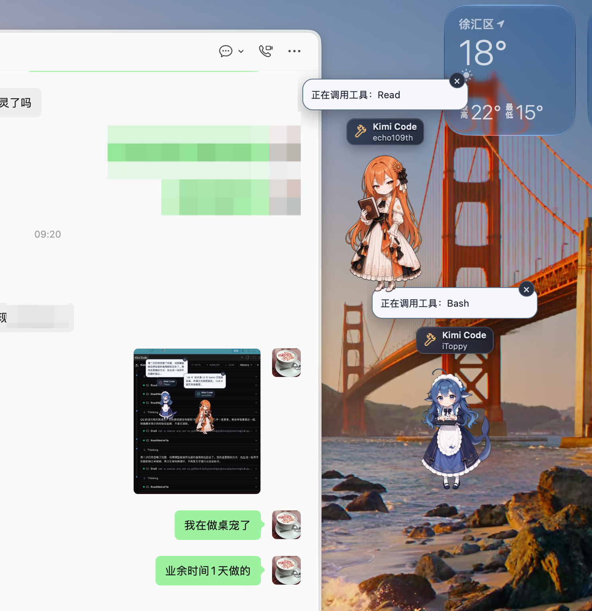

# iToppy

<p align="center">
  
</p>

<p align="center">
  <strong>AI 在忙，它在旁边比你还忙。</strong><br />
  一个住在 macOS 桌面上的 AI Coding 桌宠。
</p>

<p align="center">
  <a href="https://github.com/PeterZhao119/iToppy">GitHub</a> ·
  <a href="https://github.com/PeterZhao119">作者 PeterZhao119</a> ·
  <a href="LICENSE">MIT</a>
</p>

## 安装使用
- 从release获得最新版本的iToppy
- 安装（可能需要右键）
- 在你的ai agent里面敲一个任务，那么iToppy萌娘就会启动了

## 这是个啥？

- 自动识别本地AI Agent工具～
- 在你看剧或者微信聊天的时候，展示AI Agent的状态和进展～
- 点击气泡/标题就可以返回查看！
- 多种可爱萌娘！
- 开源，绿色，无入侵，不劫持流量！



## 现在会干什么

- 识别运行、思考、工具调用、搜索、成功、失败和取消等状态。
- 成功或失败时，用气泡展示响应摘要；点击气泡可以跳回来源应用。
- 待机时随机游走、整理裙子、抱尾巴，偶尔看起来比开发者更忙。
- 支持拖动、右键菜单、置顶、独立实例设置和可见数量上限。
- 一个工作区一只桌宠，不让历史 Session 集体跑出来开派对。
- 提供菜单栏入口和原生控制面板，管理 Agent、角色与行为设置。
- 内置 DeepSeek 娘、Claude 娘、GPT 娘、Doubao 娘、QQ 娘和 Kimi 娘，可按实例切换。

## 支持哪些 Agent？

| Agent | 当前状态 | 默认形象 |
|---|---|---|
| Kimi Code | 已支持核心事件链路，最终失败与崩溃恢复仍待增强 | Kimi 娘 |
| Codex | 已验证 CLI 提交、思考、工具、成功和失败；共用 CLI / VS Code / App rollout | GPT 娘 |
| Claude Code | 已支持共享 JSONL；真实 CLI 工具、成功和失败已验证，IDE / Desktop Code 待实机 | Claude 娘 |
| 其他框架 | 在适配器清单里排队，尚未实现 | 待定 |

Codex 和 Claude Code 的各本地 Coding 形态分别共用数据适配器，不为同一份日志养重复桌宠。普通 Chat/Cowork 不在 Claude Code 监控范围内。CLI 的精确终端标签页跳转，以及 Claude IDE/Desktop Code 的实机来源识别与跳转仍在完善。

完整清单见 [Agent 适配器登记表](design/agent-adapter-registry.md)。

## 跑起来

要求：macOS 11+、Node.js、Rust，以及一颗愿意养桌宠的心。

```bash
npm install
npm run desktop:dev
```

构建原生 App：

```bash
npm run desktop:build
```

构建产物位于：

```text
src-tauri/target/release/bundle/macos/iToppy.app
```

这是 Tauri 2 + Rust + TypeScript 的原生桌面应用，不是披着桌面外衣的浏览器首页。

## 隐私与权限

- 只读取支持 Agent 的默认会话目录及用户明确添加的目录。
- 增量读取新增日志，不扫描整块磁盘，不回放历史桌宠。
- 不申请辅助功能、屏幕录制或完全磁盘访问权限。
- 不读取或保存 Agent 密钥，也不在项目中保存完整会话正文。
- 设置保存在 `~/Library/Application Support/com.peterzhao.itoppy/settings.json`。
- Codex 等工具自己的登录凭据由对应工具管理，与 iToppy 分开。

简单说：它看你工作，但不翻你全家。

## 角色与素材

角色使用透明 Sprite Sheet，不依赖 Live2D，也不需要用户自行安装动画运行时。官方角色制作流程、已知坑和角色包验收标准已开放到 [`open-skills/itoppy-character-production/SKILL.md`](open-skills/itoppy-character-production/SKILL.md)，各角色目录中还保留了生成日志与素材授权说明。

代码采用 [MIT 许可证](LICENSE)。角色名称、商标、原始参考图和衍生素材有各自的权利边界，**不默认等同于 MIT 授权**；公开再分发前请查看各角色目录中的 `NOTICE.md` 并确认来源与授权。

## 还想做什么

- 接入更多 AI Coding Agent。
- 更准确的终端会话与 App 窗口跳转。
- 补全崩溃恢复、搜索、取消等边缘状态。
- 继续做更可爱、但不妨碍工作的动作。

## 参与开发

欢迎提 Issue 或 PR。新增 Agent 时，优先实现独立适配器并复用统一事件模型，不要把某家日志格式硬塞进另一只桌宠的脑子里。

公开制作经验入口：

- [角色形象制作指南](open-skills/itoppy-character-production/SKILL.md)
- [Agent 适配器接入指南](open-skills/itoppy-agent-adapter/SKILL.md)
- [开放技能索引](open-skills/README.md)

项目设计与适配器资料在 [`design/`](design/) 目录。

---

由 [PeterZhao119](https://github.com/PeterZhao119) 制作。代码可以开源，桌宠的可爱暂时不打算收敛。
